# Piano Fundamentals Trainer

连接兼容 MIDI 电钢琴或键盘，练习识谱、和弦与音程，并回顾练习表现。 
A free Android tablet app for reading notes, practicing chords and intervals, and reviewing your progress with a compatible MIDI piano or keyboard.

Android 1.7.1

[下载正式 APK / Download APK](https://github.com/Natural516/piano-fundamentals-trainer/releases/latest) · [中文](#zh) · [English](#en) · [更新记录 / Changelog](CHANGELOG.md)

## 中文

### 为钢琴学习者练习基本功

Piano Fundamentals Trainer（钢琴基本功训练器）面向拥有兼容 MIDI 键盘、希望强化谱面识读、和弦构成与音程定位的钢琴学习者。看平板上的题目，在真实键盘上作答，让五线谱、乐理与手指的键盘位置建立联系。

- **识谱练习**：识读五线谱单音或双音，在键盘上弹出对应音符。可选择高音谱表、低音谱表或大谱表，以及调性、题数等设置。它训练音符识读与键盘定位，不是完整曲谱的连续视奏。
- **和弦练习**：通过分解和弦与柱式和弦，练习构成音、转位与键盘定位。**循序练习**围绕一个选定大调的七个调内和弦，随题数逐步扩展三和弦、七和弦与转位；**综合随机**混合当前练习支持的完整根音、和弦类型与转位范围，不限于单一调性。
- **音程练习**：按指定低音构造八度内 **26 种音程**，支持固定题数、无限练习与可选答案提示。
- **乐理工具**：查询和弦、大调音阶、调号与音程。
- **练习历史与识谱分析**：回顾已保存的结果、练习趋势，以及需要重点巩固的音符。

### 真实应用画面

以下画面均来自 **Android 1.7.1 正式应用**，在 Lenovo TB375FC 上使用内置浅色主题。报告与分析展示已有真实练习记录。

#### 首页

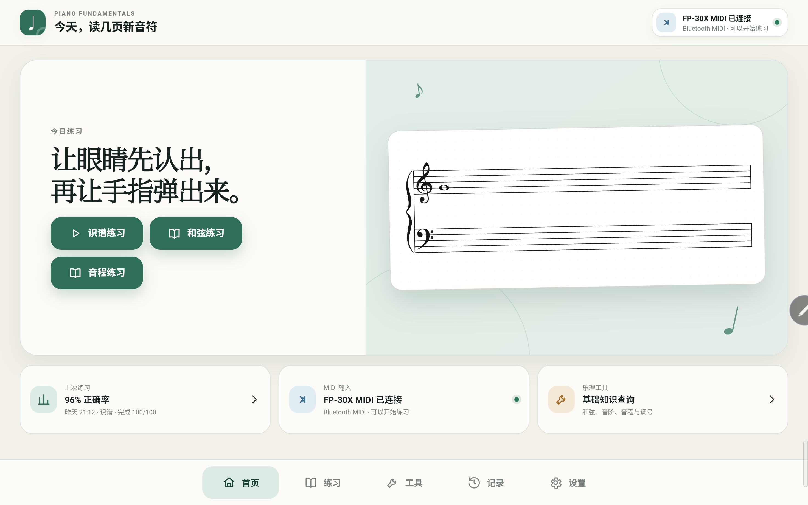

查看识谱、和弦与音程练习画面

#### 识谱练习

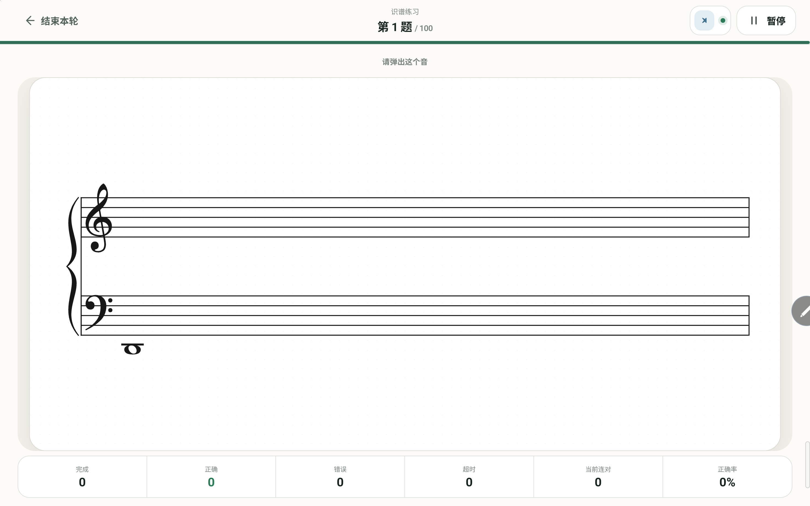

#### 和弦练习

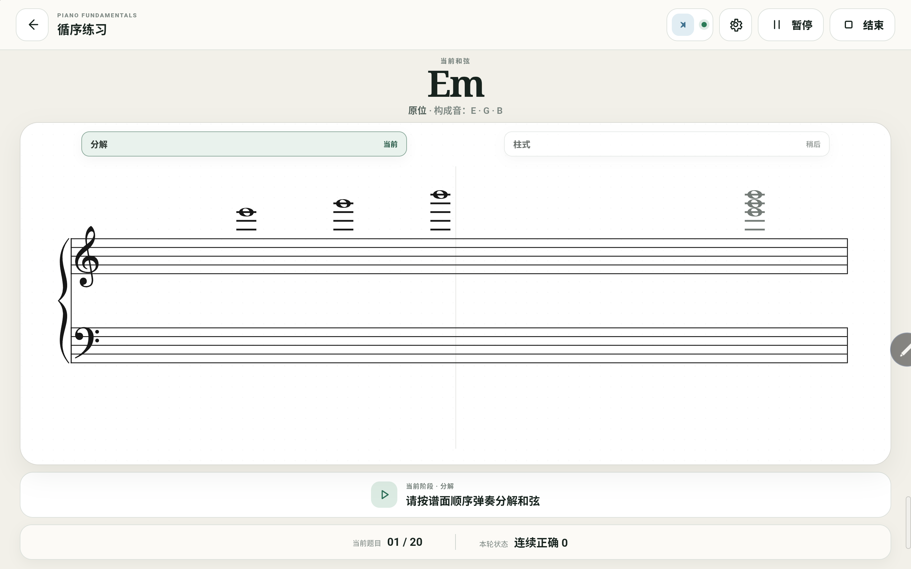

#### 音程练习

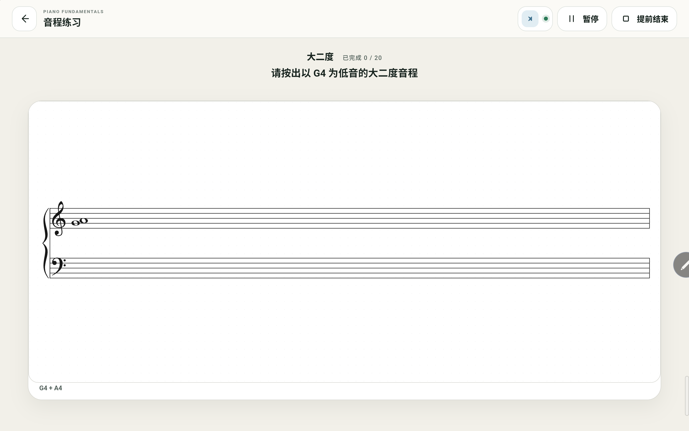

#### 单次识谱报告

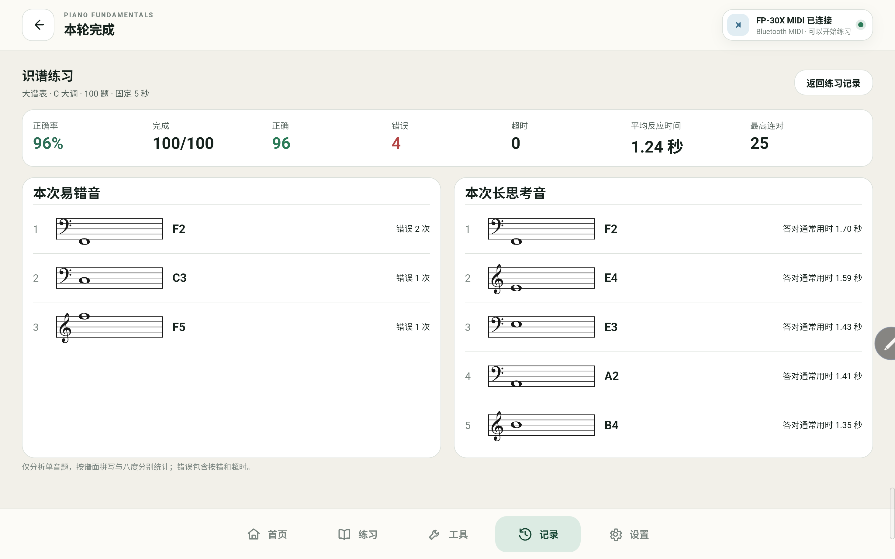

#### 长期识谱分析

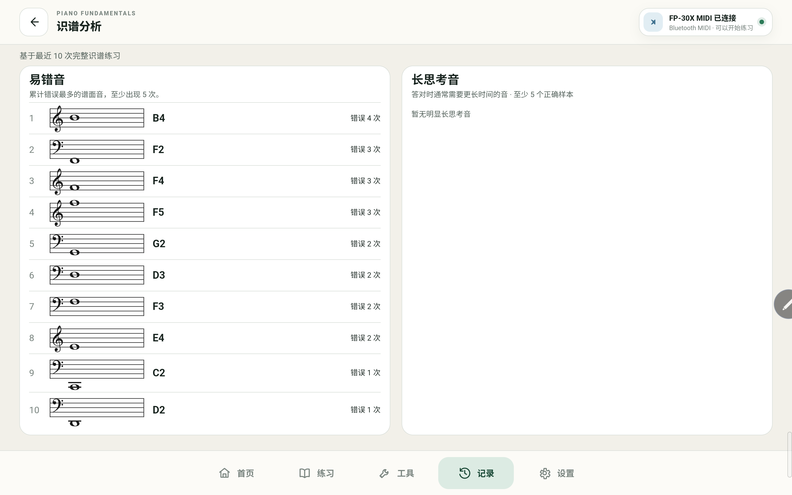

### 为什么使用它

- **练在真实键盘上**：把谱面识读与实际按键联系起来。
- **即时反馈**：收到 MIDI 输入后判断当前题目，帮助发现识读和定位错误。
- **有针对性地复习**：用报告和逐音分析找到反复出错或答对较慢的音符。
- **记录保存在本地**：练习历史与设置保存在设备上；下载和检查更新需要网络。

MIDI 反馈用于音符与练习任务判定，不评价手型、音色、触键质量或音乐表现力。

### 设备要求与 MIDI 连接

- **Android 7.0 或更高版本**，主要面向横屏 Android 平板。达到最低系统要求，不代表所有设备都已通过 MIDI 兼容测试。
- 具有 MIDI 输出能力的电钢琴、电子键盘或其它兼容 MIDI 输入设备；支持 **Bluetooth MIDI** 与 **USB MIDI**，一次连接一个输入设备。
- USB 连接需要兼容的数据线及平板所需的 USB 转接器 / OTG；Bluetooth MIDI 需要设备和 Android 的相应支持。

应用不绑定钢琴品牌或型号。**Lenovo TB375FC + Roland FP-30X** 是已验证的设备组合，不是设备白名单；其它设备的兼容性取决于 MIDI 设备、Android 系统和连接方式。

> 普通蓝牙音频连接不等于 Bluetooth MIDI。应用接收 MIDI 音符数据，不通过麦克风识别普通声学钢琴的声音。

### 如何开始

1. 从 [Latest Release](https://github.com/Natural516/piano-fundamentals-trainer/releases/latest) 的 Assets 下载正式 `.apk`，按 Android 提示安装。
2. 打开 **设置 → MIDI 输入设备**。Bluetooth MIDI：开启钢琴和系统蓝牙，允许附近设备权限，点击 **扫描 MIDI 设备**，在列表中点击 **连接**。USB MIDI：用数据线连接后点击 **扫描 MIDI 设备** 刷新列表，再连接对应设备。
3. 确认状态为 **可以开始练习**。在首页选择 **识谱练习、和弦练习或音程练习**；查看练习配置后开始。和弦练习先选择 **循序练习 / 综合随机**。

在 **设置** 中可点击选择 **中文 / English** 和浅色 / 深色主题。练习可以暂停；提前结束时，可以选择保存记录或 **不保存并结束**。

### 下载与升级

当前稳定版本：**Android 1.7.1**，可以免费获取。

**[下载正式 APK](https://github.com/Natural516/piano-fundamentals-trainer/releases/latest)**

升级时使用正式 Release 的 APK 覆盖安装，或在应用中打开 **检查更新**。Android 会要求确认安装。不要为升级先卸载应用或清除数据；保留原安装才能保留本地记录与设置。

### 练习历史与识谱分析

在 **记录** 中回顾已保存练习的完成题数、正确率和练习趋势。单次识谱报告展示 **本次易错音** 与 **本次长思考音**，帮助决定下一轮重点练什么。

在 **记录 → 识谱筛选 → 识谱分析** 中，查看最近最多 10 次完整识谱练习的长期表现。逐音分析仅使用实际存在的 **单音逐音数据**，按谱面拼写和八度分别统计；双音练习不提供同等逐音分析。数据不足或未出现明显弱项时，页面会如实显示相应状态。

### 个性化主题

使用内置浅色 / 深色外观，也可以从 [官方主题仓库](https://github.com/Natural516/piano-fundamentals-trainer-themes) 下载 `.pftheme`，在 **设置 → 导入主题包** 中安装。

**Bocchi（孤独摇滚）1.1.0** 提供乐队手账风格，以及识谱、和弦和音程练习的个性化视觉。主题包与应用版本分别更新，请按主题下载页的兼容说明选择。

### 开源与开发文档

代码采用 [Apache License 2.0](LICENSE)。开发与维护信息：

- [构建指南](BUILDING.md)
- [开发指南](DEVELOPMENT.md)
- [安全说明](SECURITY.md)
- [更新记录](CHANGELOG.md)
- [第三方声明](THIRD_PARTY_NOTICES.md)
- [截图来源](docs/screenshots/README.md)

[返回顶部](#piano-fundamentals-trainer) · [English](#en)

---

## English

### Focused fundamentals for piano learners

Piano Fundamentals Trainer is for learners with a compatible MIDI keyboard who want to strengthen note reading, chord knowledge and interval placement. Read the prompt on your tablet, then answer on your physical keyboard to connect notation and theory with the keys under your fingers.

- **Sight Reading**: identify single notes or pairs on a staff and play the matching keys. Choose treble, bass or grand staff, a key and a question count. This is note-reading and keyboard-location practice, not continuous sight-reading of complete scores.
- **Chord Practice**: practice chord tones, inversions and keyboard placement through arpeggios and block chords. **Progressive practice** uses the seven diatonic chords of one selected major key, expanding into triads, seventh chords and inversions according to the question count. **Mixed practice** draws from the full root, chord-type and inversion range supported by the practice module, without restricting the session to one key.
- **Interval Practice**: build **26 interval types within the octave** above a specified bass note, with fixed-count or unlimited sessions and optional answer hints.
- **Theory Tools**: look up chords, major scales, key signatures and intervals.
- **Practice History and Sight Reading Analysis**: review saved results, practice trends and notes that need more attention.

### Real app screenshots

These captures are from the **Android 1.7.1 production app** on a Lenovo TB375FC with the built-in Light theme. Reports and analysis use existing real practice records.

#### Home

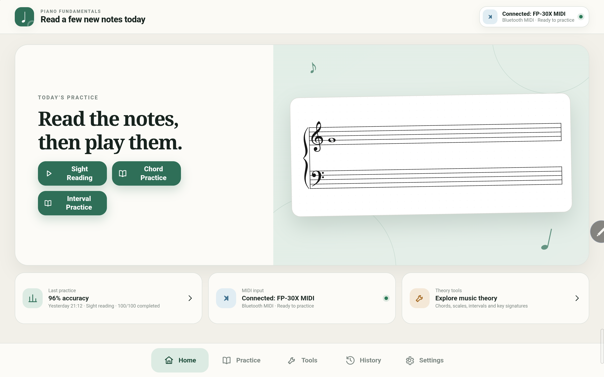

View Sight Reading, Chord Practice and Interval Practice

#### Sight Reading

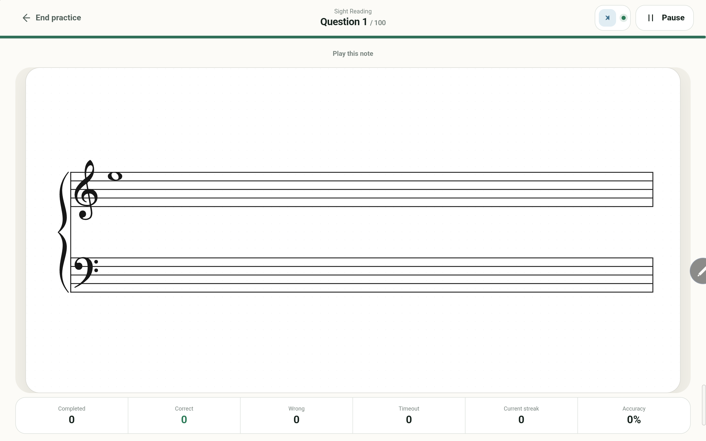

#### Chord Practice

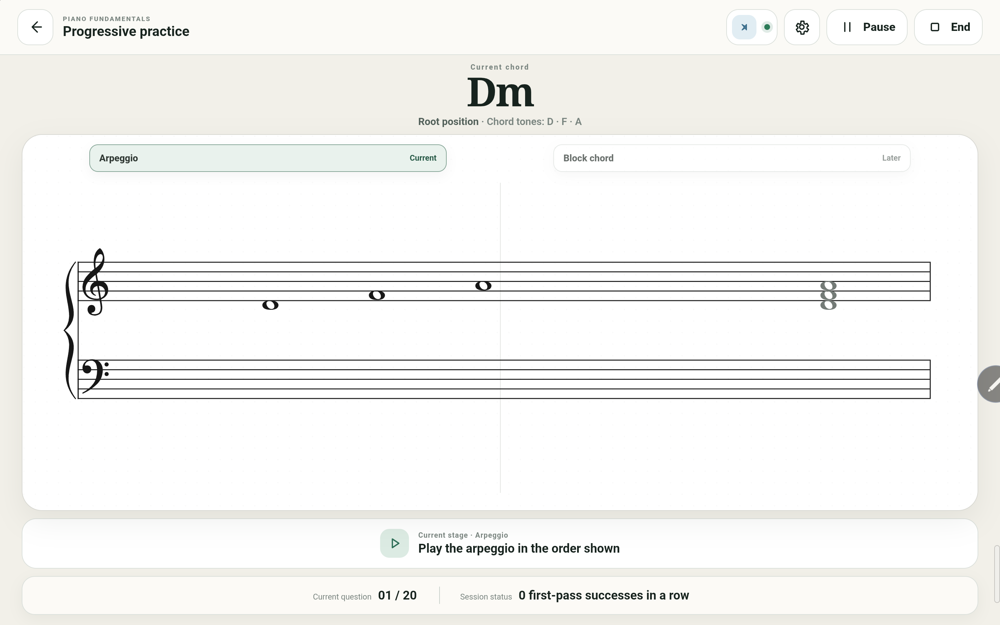

#### Interval Practice

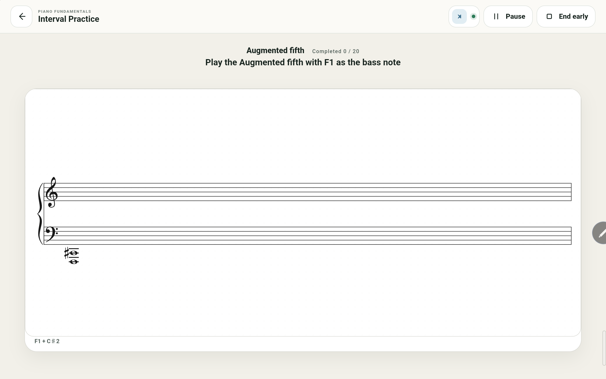

#### Single-session sight-reading report

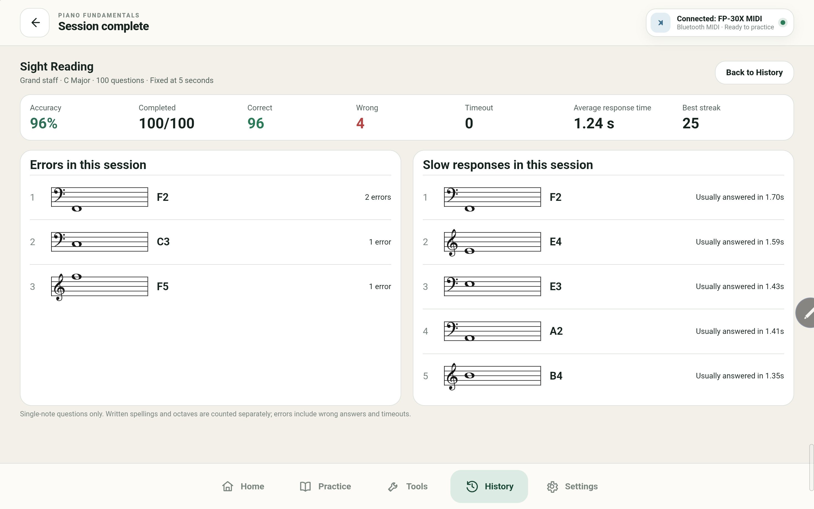

#### Long-term sight-reading analysis

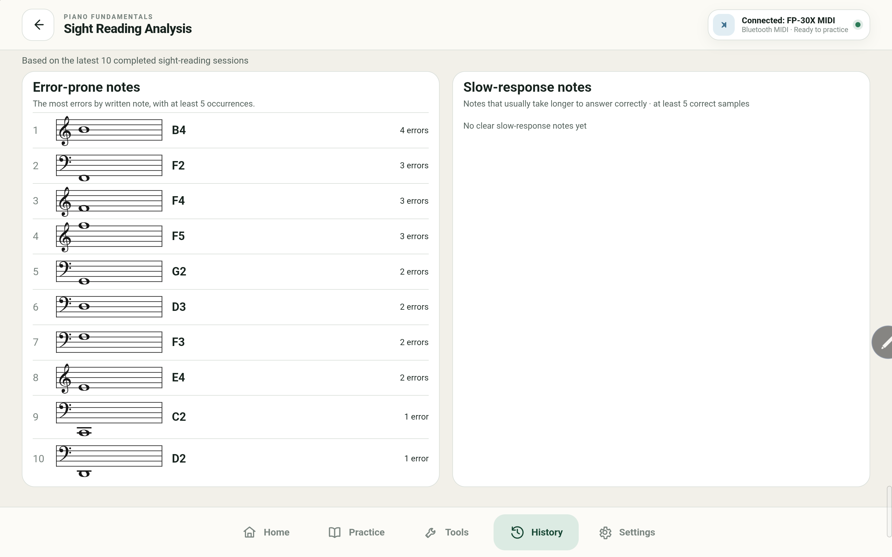

### Why use it

- **Practice on a physical keyboard**: connect written notes with actual keys.
- **Get immediate feedback**: MIDI input is used to judge the current task and reveal reading or placement errors.
- **Review with a purpose**: reports and per-note analysis highlight recurring errors and slower correct responses.
- **Keep records locally**: practice history and settings stay on your device; downloads and update checks need a network connection.

MIDI feedback assesses notes and practice tasks, not hand posture, tone, touch quality or musical expression.

### Device requirements and MIDI

- **Android 7.0 or later**, primarily on landscape Android tablets. Meeting the minimum OS requirement does not mean every device has passed MIDI compatibility testing.
- A digital piano, electronic keyboard or other compatible input device with MIDI output. **Bluetooth MIDI** and **USB MIDI** are supported, with one active input device at a time.
- USB connections need a compatible data cable and any USB adapter / OTG required by your tablet. Bluetooth MIDI requires support from both the instrument and Android.

The app is not tied to a piano brand or model. **Lenovo TB375FC + Roland FP-30X** is a tested combination, not a device whitelist. Compatibility depends on the MIDI device, Android system and connection method.

> Bluetooth audio is not Bluetooth MIDI. The app receives MIDI note data; it does not recognize an acoustic piano through a microphone.

### Get started

1. Download the production `.apk` from the Assets section of the [Latest Release](https://github.com/Natural516/piano-fundamentals-trainer/releases/latest) and follow Android's installation prompts.
2. Open **Settings → MIDI input device**. For Bluetooth MIDI, turn on the instrument and system Bluetooth, allow nearby-device permission, then choose **Scan MIDI devices** and **Connect** beside your device. For USB MIDI, connect the data cable, choose **Scan MIDI devices** to refresh the list, then connect the matching device.
3. Check for **Ready to practice**. Choose **Sight Reading, Chord Practice or Interval Practice** from Home, review the configuration and start. Chord Practice begins with a choice of **Progressive practice / Mixed practice**.

In **Settings**, choose **中文 / English** and Light / Dark appearance. You can pause a session; when ending early, choose whether to save the record or **End without saving**.

### Download and update

Latest stable version: **Android 1.7.1**, available free of charge.

**[Download the production APK](https://github.com/Natural516/piano-fundamentals-trainer/releases/latest)**

To update, install the official Release APK over the existing app, or use **Check for updates** in the app. Android asks you to confirm installation. Do not uninstall or clear app data just to update: keep the existing installation to retain local records and settings.

### Practice history and sight-reading analysis

Open **History** to review completed-question counts, accuracy and practice trends. A single-session sight-reading report highlights **Errors in this session** and **Slow responses in this session**, helping you choose what to focus on next.

Choose **History → Sight reading filter → Sight Reading Analysis** to review up to the latest 10 completed sight-reading sessions. Per-note analysis uses only actual **single-note detail**, counting written spellings and octaves separately. Double-note practice does not provide equivalent per-note analysis. The page shows an honest empty state when data is insufficient or no clear weakness is found.

### Personalize the appearance

Use the built-in Light / Dark themes, or download a `.pftheme` from the [official theme repository](https://github.com/Natural516/piano-fundamentals-trainer-themes) and open **Settings → Import theme package**.

**Bocchi 1.1.0** offers a band-journal style and personalized visuals for Sight Reading, Chord Practice and Interval Practice. Theme packages and the app are versioned separately; check the theme download page for compatibility.

### Open source and development

The code is licensed under [Apache License 2.0](LICENSE). For building and maintaining the app:

- [Building](BUILDING.md)
- [Development](DEVELOPMENT.md)
- [Security](SECURITY.md)
- [Changelog](CHANGELOG.md)
- [Third-party notices](THIRD_PARTY_NOTICES.md)
- [Screenshot provenance](docs/screenshots/README.md)

[Back to top](#piano-fundamentals-trainer) · [中文](#zh)
